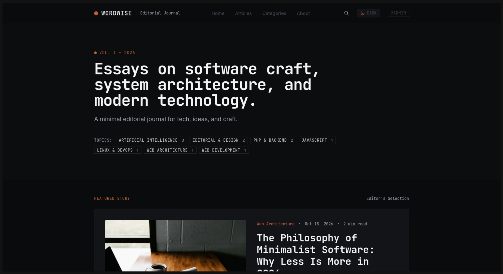

# WordWise — Modern Editorial Blogging Platform & PHP CMS



> **WordWise** is a modern, minimalist blogging platform and content management system inspired by independent online journals, developer blogs, and typewriter aesthetics. Built on native PHP, MariaDB, and Tailwind CSS, WordWise pairs clean monospace typography with an immersive block-based editor, live autosave, optimistic concurrency locking, and secure Google OAuth 2.0 authentication.

---

## Key Features

### 1. Minimalist Editorial & Typewriter Design
* **Distinctive Typography:** Set in **JetBrains Mono** for headings, metadata badges, timestamps, and code, paired with **Inter** for reading body copy.
* **Restrained Visual Language:** Monochrome editorial palette with subtle terracotta accenting, understated dividers, and generous whitespace.
* **Dark / Light / System Theme:** Instant zero-flash theme persistence via `localStorage` and system preference detection.
* **Distraction-Free Reading:** Comfortable reading width (`68ch`), live reading progress bar, dynamic Table of Contents, and print-ready stylesheets.

### 2. Immersive Block-Based Article Editor
* **Block Composition (Editor.js):** Write using structured blocks—Headings (H2–H4 with auto-generated anchors), Paragraphs, Lists, Quotes with citations, Delimiters, Code with syntax highlighting, Callouts/Tips/Warnings, Images with captions, and Video Embeds (YouTube, Vimeo, MP4).
* **Zen / Fullscreen Mode:** Single-click focus mode (`Alt+Z` or `Esc`) that hides all admin chrome for a clean, centered writing canvas.
* **Slash (`/`) Commands:** Rapid block insertion using `/` or `Tab`.
* **Live Word & Read Time Metrics:** Real-time word counter, character counter, and estimated read time calculated across all blocks.
* **Media Library Picker:** Browse uploaded assets or upload artwork directly into your article or cover image.

### 3. Background Autosave & Concurrency Engine
* **Debounced Background Autosave:** Automatically streams edits to `post_autosaves` in the background every 4 seconds of idle typing.
* **Optimistic Locking:** Detects version collisions (`post_version`) if another tab or author modified the article, preventing silent overwrites.
* **Draft Recovery:** Automatically detects and offers to restore unsaved drafts upon opening the editor.
* **Revision Checkpoints:** Instant historical snapshots recorded to `post_revisions` before every publish or manual checkpoint.

### 4. Authentication, Social Login & Security
* **Google OAuth 2.0 & OpenID Connect:** Native PKCE (RFC 7636) code challenge authorization, state/nonce protection, and safe account linking that prevents email hijacking.
* **Local Authentication:** Sign-up, sign-in, real-time password strength meter, password visibility toggles, and secure Argon2id / bcrypt hashing.
* **Persistent Sessions:** High-entropy SHA-256 remember-me tokens with automatic cookie rotation.
* **Email Verification & Password Reset:** Cryptographic single-use token verification and 1-hour expiry reset flows.
* **Role-Based Access Control (RBAC):** Gated capabilities for `admin`, `editor`, `author`, and `subscriber`.
* **Audit Logging:** System-wide activity tracking recording IP address, actor, and action details in `audit_logs`.

### 5. Publishing Lifecycle & Automation
* **Lifecycle States:** `published`, `draft`, `scheduled`, and `archived`.
* **Scheduled Publisher Cron:** Automated CLI worker (`cron/publish_scheduled.php`) that transitions scheduled articles to published status when due.
* **Editorial Preview Mode:** Authenticated editors can preview unpublished drafts with full site styling via `?preview=true`.

---

## Technology Stack

* **Backend:** PHP 8.2+ (tested through PHP 8.5) with PDO prepared statements and strict typing
* **Database:** MariaDB 10.5+ / MySQL 8.0+
* **Frontend:** Semantic HTML5, Tailwind CSS 3.4 (`@tailwindcss/typography`), vanilla JavaScript
* **Editor:** Editor.js with Header, List, Quote, Delimiter, CodeTool, Warning, ImageTool, and Embed plugins
* **Syntax Highlighting:** Highlight.js (bundled locally with `github-dark` theme)
* **Web Server:** Apache 2.4 (`mod_rewrite`, `mod_mpm_prefork`, `mod_php`) or Nginx

---

## Getting Started

### Prerequisites

* Linux / macOS / Windows (WSL recommended)
* **PHP 8.2 or newer** with extensions: `pdo_mysql`, `mysqli`, `fileinfo`, `curl`, `mbstring`, `openssl`, `dom`
* **MariaDB** or **MySQL** database server
* **Apache** with `mod_rewrite` enabled (or Nginx with standard front-controller rewrite)
* **Node.js & npm** (only required if rebuilding Tailwind CSS)

---

### Step 1: Clone the Repository

```bash
git clone https://github.com/realronak/WordWise.git
cd WordWise
```

---

### Step 2: Database Setup

1. Create a MariaDB database and user:
   ```sql
   CREATE DATABASE wordwise CHARACTER SET utf8mb4 COLLATE utf8mb4_unicode_ci;
   CREATE USER 'wordwise_user'@'localhost' IDENTIFIED BY 'wordwise_local';
   GRANT ALL PRIVILEGES ON wordwise.* TO 'wordwise_user'@'localhost';
   FLUSH PRIVILEGES;
   ```

2. Import the clean starter schema and seed articles:
   ```bash
   mariadb -u wordwise_user -pwordwise_local wordwise < database/schema.sql
   ```

---

### Step 3: Environment Configuration (`.env`)

Copy the example environment template to `.env`:

```bash
cp .env.example .env
```

Open `.env` and verify your configuration:

```ini
# Application Configuration
APP_NAME=WordWise
APP_ENV=local
APP_URL=http://localhost

# Database Configuration
DB_HOST=localhost
DB_USER=wordwise_user
DB_PASS=wordwise_local
DB_NAME=wordwise

# Google OAuth 2.0 / OpenID Connect (Optional)
# Obtain from https://console.cloud.google.com/apis/credentials
GOOGLE_CLIENT_ID=
GOOGLE_CLIENT_SECRET=
GOOGLE_REDIRECT_URI=http://localhost/auth/google/callback.php

# Email Settings
MAIL_FROM_ADDRESS=editor@wordwise.local
MAIL_FROM_NAME=WordWise
```

> [!IMPORTANT]
> Never commit your `.env` file to version control. The repository's `.gitignore` and Apache configuration automatically protect `.env` from exposure.

---

### Step 4: Web Server Configuration

#### Apache
Set the Apache `DocumentRoot` to your WordWise folder. Ensure `AllowOverride All` is set so [`.htaccess`](file:///home/ron/Projects/WordWise/.htaccess) functions:

```apache
<VirtualHost *:80>
    ServerName localhost
    DocumentRoot "/path/to/WordWise"
    <Directory "/path/to/WordWise">
        Options Indexes FollowSymLinks
        AllowOverride All
        Require all granted
    </Directory>
    ErrorLog /var/log/httpd/wordwise_error.log
    CustomLog /var/log/httpd/wordwise_access.log combined
</VirtualHost>
```

Restart Apache:
```bash
sudo systemctl restart httpd   # Arch / Omarchy / RHEL
# or: sudo systemctl restart apache2  # Ubuntu / Debian
```

#### Quick Local PHP Development Server (Alternative)
```bash
php -S localhost:8000
```
*(Open [http://localhost:8000](http://localhost:8000) in your browser)*

---

### Step 5: Default Admin Credentials

* **Login URL:** [http://localhost/login.php](http://localhost/login.php)
* **Username:** `admin`
* **Password:** `WordWise@2026!`

*(You can update your username, display name, and password immediately in your [Profile Workspace](http://localhost/profile.php)).*

---

### Step 6: Scheduled Article Publishing (Cron)

To automatically publish scheduled articles when their release date arrives, set up a cron job or systemd timer:

```bash
# Run manually:
php cron/publish_scheduled.php

# Or add to crontab (runs every minute):
* * * * * /usr/bin/php /path/to/WordWise/cron/publish_scheduled.php --json >> /var/log/wordwise_cron.log 2>&1
```

---

### Step 7: Compiling Tailwind CSS (Optional)

All production CSS is pre-compiled and committed in [`css/main.css`](file:///home/ron/Projects/WordWise/css/main.css). If you make styling modifications in [`src/input.css`](file:///home/ron/Projects/WordWise/src/input.css) or templates:

```bash
# Install dependencies
npm install

# Rebuild minified CSS
npm run build

# Watch for changes during development
npm run watch
```

---

## Automated Test Suites

WordWise includes an automated verification test suite:

```bash
# Run all verification suites:
php tests/test_milestone2.php && php tests/test_milestone3.php && php tests/test_milestones4_6.php
```

Covering:
* **Milestone 2 (Auth & Profiles):** Safe redirects, registration gates, password strength, single-use token verification, session lifecycle, remember-me hashing, and profile updates.
* **Milestone 3 (Google OAuth):** PKCE RFC 7636 verifier/challenge generation, Base64URL encoding, state verification, provider unlinking security, and account linking.
* **Milestones 4–6 (Editor, Media & Cron):** Canonical block parsing, XSS sanitization, HTML-to-blocks conversion, live draft autosaving, optimistic locking collisions, revision snapshots, media uploads, and scheduled publication execution.

---

## Directory Structure

```text
WordWise/
├── .env.example             # Environment template (safe to commit)
├── .gitignore               # Strict exclusion rules for .env, backups, and logs
├── .htaccess                # Apache rewrite rules & security headers
├── 404.php                  # Minimalist editorial 404 error page
├── about.php                # About the publication page
├── articles.php             # Full article catalog with category/tag filters
├── categories.php           # Taxonomy directory & topic index
├── login.php                # Authentication page with Google OAuth button
├── logout.php               # Secure session invalidation
├── profile.php              # User profile workspace & connected accounts
├── register.php             # User registration & password strength meter
├── verify-email.php         # Single-use email verification handler
├── forgot-password.php      # Password reset request page
├── reset-password.php       # Password reset token confirmation page
├── post.php                 # Single article reading experience
├── rss.php                  # RSS 2.0 syndicated feed
├── sitemap.php              # XML sitemap generator
├── admin/
│   ├── index.php            # Editorial dashboard & analytics metrics
│   ├── posts.php            # Article catalog management
│   ├── post-edit.php        # Immersive Editor.js block composer & Zen mode
│   ├── categories.php       # Category taxonomy manager
│   ├── tags.php             # Tag taxonomy manager
│   ├── media.php            # Media library asset repository
│   ├── users.php            # User administration & role management
│   ├── settings.php         # Site configuration & registration toggles
│   ├── audit.php            # Security & action audit logs
│   ├── api/
│   │   ├── autosave.php     # Background autosave & optimistic concurrency API
│   │   └── media.php        # Async media search & upload API
│   └── includes/
│       ├── admin_header.php # Admin navigation & layout header
│       └── admin_footer.php # Admin layout footer
├── auth/
│   ├── google/
│   │   ├── redirect.php     # Google OAuth PKCE redirect initiator
│   │   └── callback.php     # Google OAuth token exchange & user linking
│   └── unlink.php           # External provider unlinking confirmation
├── cron/
│   └── publish_scheduled.php # Automated scheduled article publisher
├── css/
│   ├── main.css             # Compiled Tailwind CSS production stylesheet
│   └── vendor/              # Local Highlight.js dark theme stylesheet
├── database/
│   ├── schema.sql           # Clean starter database dump with seed dispatches
│   └── migrations/          # Incremental migration SQL files
├── images/                  # Media library files & WordWise screenshot
├── includes/
│   ├── db.php               # PDO & MySQLi database connection abstraction
│   ├── auth.php             # Authentication, session, and role functions
│   ├── blocks.php           # Editor.js block rendering & HTML sanitizer
│   ├── oauth.php            # Google OAuth 2.0 & OpenID Connect PKCE engine
│   ├── env.php              # Lightweight .env environment loader
│   ├── security.php         # CSRF verification & HTML sanitization
│   ├── header.php           # Public header & typography loading
│   ├── navigation.php       # Public responsive navigation
│   └── footer.php           # Public footer
├── js/
│   ├── theme.js             # Theme toggle & dark/light persistence
│   └── vendor/              # Standalone Editor.js plugins & Highlight.js
├── scripts/                 # Editorial post seeder utility
├── src/                     # Tailwind source input CSS
└── tests/                   # Automated PHP test suites (Milestones 2–6)
```

---

## License

This project is open-source and available under the [MIT License](LICENSE).
